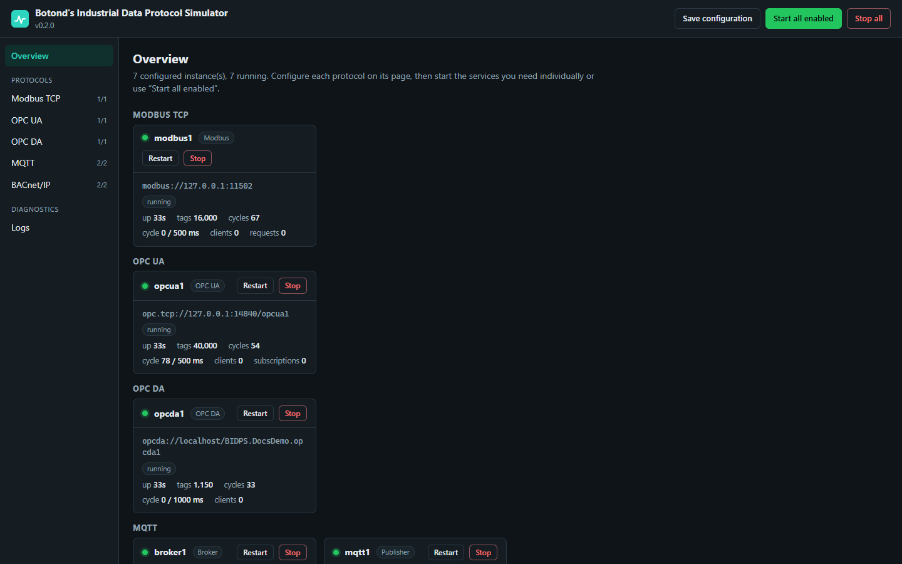
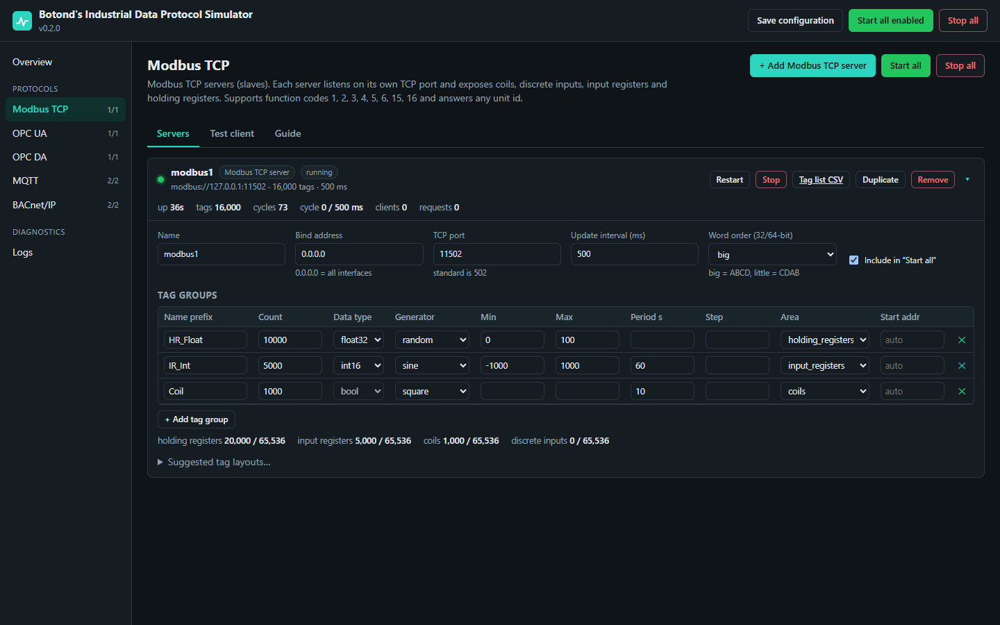
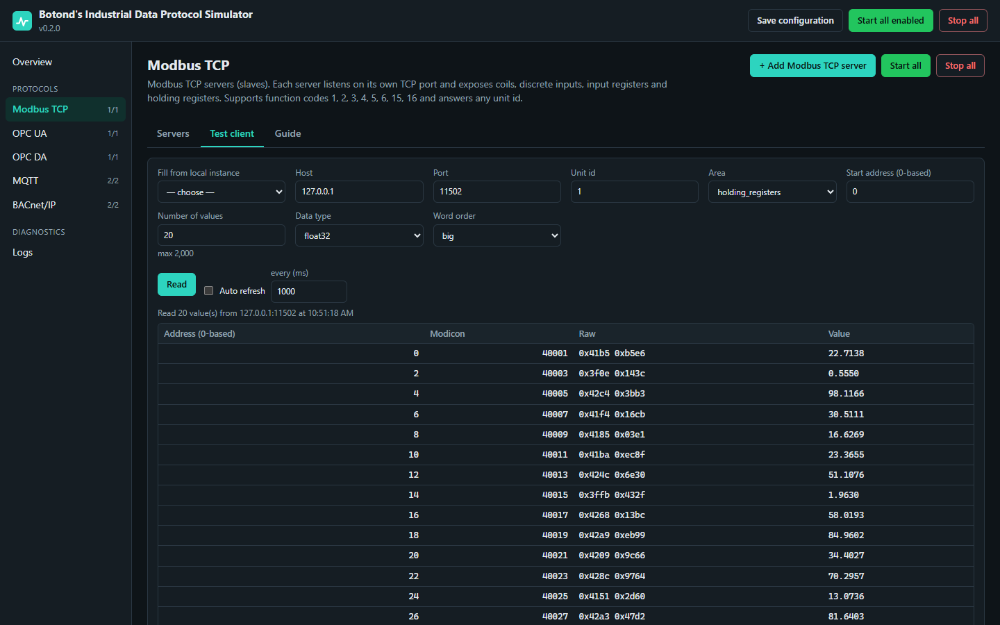
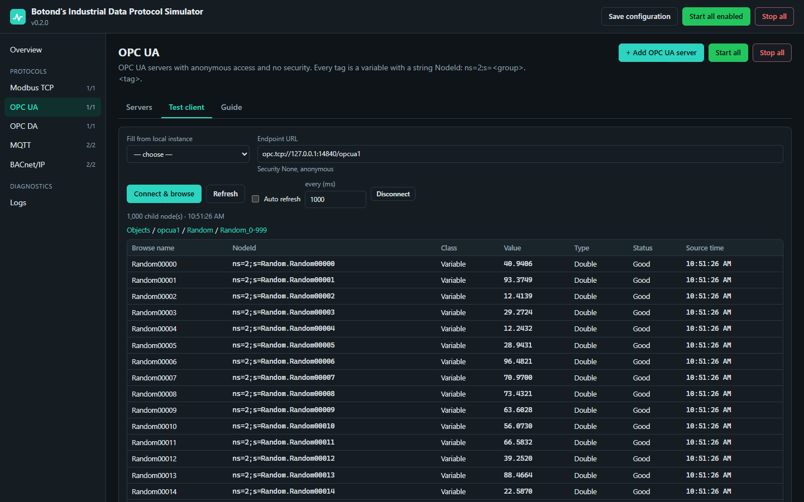
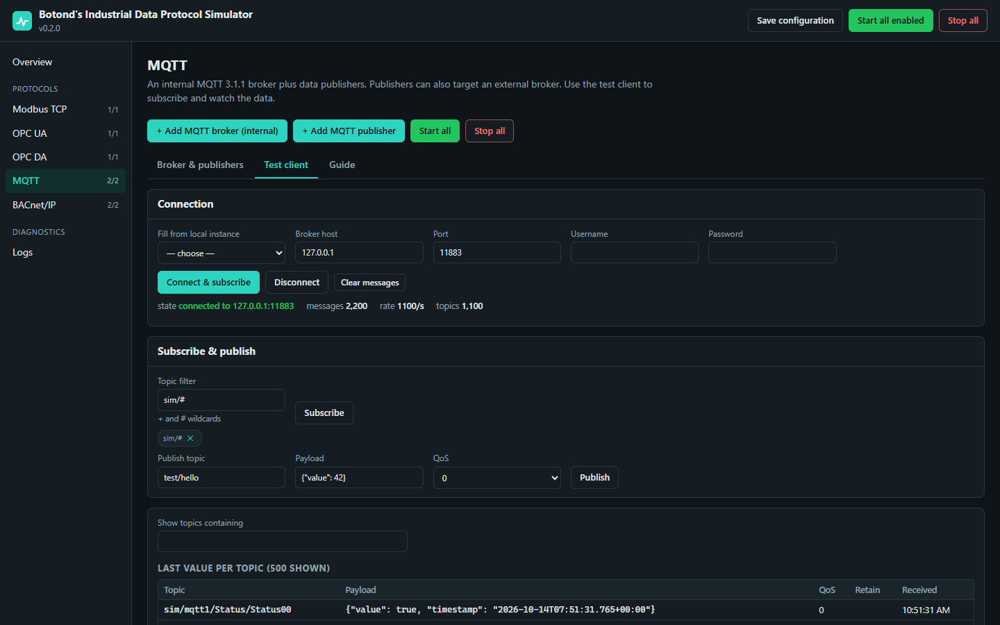
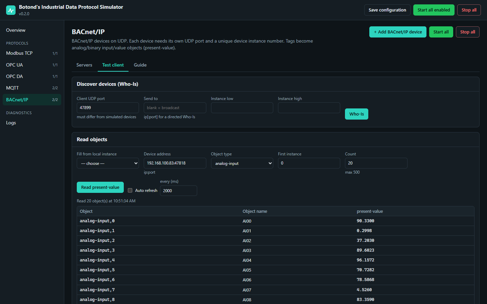
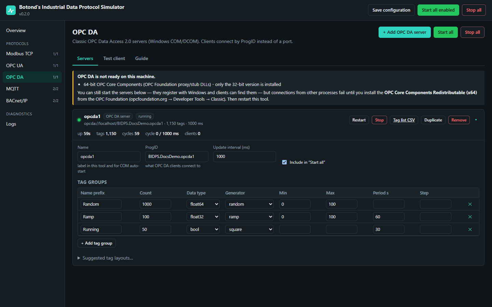
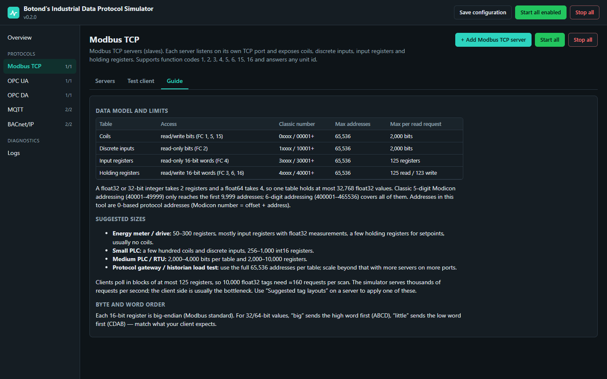
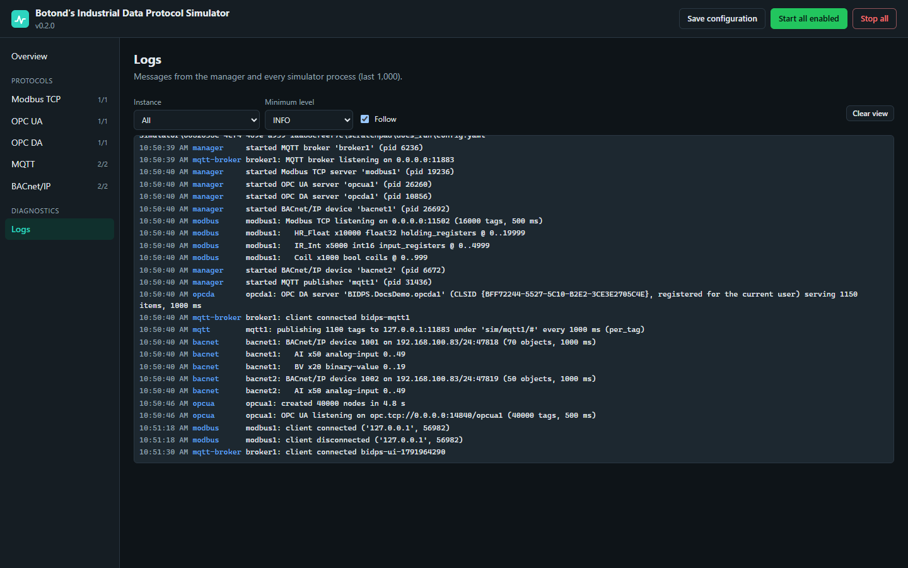

# Botond's Industrial Data Protocol Simulator

Simulates industrial data sources for testing historians, SCADA, IIoT gateways and connectors, with a web UI to configure, start and stop each one and built-in test clients to see the data.

| Protocol | Role | Default port |
|---|---|---|
| Modbus TCP | server (slave) | TCP 1502 (standard 502) |
| OPC UA | server | TCP 4840 |
| OPC DA 2.05 | COM server (Windows) | ProgID `BIDPS.OpcDaSimulator.1` |
| MQTT | internal broker + data publishers | TCP 1883 |
| BACnet/IP | device | UDP 47808 |

Each protocol can have any number of instances. Each instance runs on its own port (or ProgID) and in **its own OS process**, so instances use separate CPU cores and don't slow each other down. An instance has one or more **tag groups**, each with a tag count, data type, value generator and update rate. One example: 40,000 random doubles every 500 ms on OPC UA.



## Run the Windows build (no Python needed)

1. Unzip `BotondsProtocolSimulator-<version>-win64.zip`. You can build it yourself, see [Building](#building).
2. Run `BotondsProtocolSimulator.exe`. A console window shows the log; closing it stops everything.
3. Open **http://127.0.0.1:8088**.

Settings are kept in `config.yaml` next to the exe. The same command-line options as below apply, e.g. `BotondsProtocolSimulator.exe --port 9000 --host 0.0.0.0` or `--headless`.

The first time BACnet or a server bound to `0.0.0.0` starts, Windows Firewall may ask whether to allow the app. Allow it on private networks if other machines should reach it.

## Run from source

```bash
python -m venv .venv
.venv\Scripts\python -m pip install -r requirements.txt
.venv\Scripts\python -m simulator
```

Open **http://127.0.0.1:8088**. Each protocol page has three tabs:

- **Servers**: add, configure, duplicate, start, stop and restart instances, apply suggested tag layouts, and download each instance's tag list (addresses, NodeIds, item IDs, topics) as CSV.
- **Test client**: a built-in client for the protocol. Read Modbus registers, browse OPC UA or OPC DA, subscribe and publish on MQTT, or run BACnet Who-Is and read objects. Values refresh automatically and changes are highlighted.
- **Guide**: protocol limits and sizing suggestions, including Modbus table sizes per device class.

**Logs** shows output from every process. **Save configuration** writes [config.yaml](config.yaml). Starting an instance also saves pending changes.

Other ways to run:

```
python -m simulator --port 9000 --host 0.0.0.0     # UI on another port / reachable from the network
python -m simulator --headless                     # no UI: start every enabled instance in config.yaml
python -m simulator --headless --export-tags tagmaps
```

## Screenshots

| | |
|---|---|
|  **Modbus server**: tag groups, address usage per table, live stats |  **Modbus test client**: raw registers and decoded float32 values |
|  **OPC UA test client**: browsing a 40,000-tag server |  **MQTT test client**: subscribed through the internal broker, ~1,100 msg/s |
|  **BACnet/IP test client**: reading present-values |  **OPC DA server** with the prerequisite check |
|  **Guide**: Modbus limits and sizing suggestions |  **Logs** from every process |

The screenshots were taken with the packaged build on alternate ports. To regenerate them, start the simulator, press **Start all enabled**, then run `.venv\Scripts\python tools\screenshots.py --url http://127.0.0.1:8088` (needs Edge or Chrome).

## Tag groups

| Field | Values |
|---|---|
| `name` | tag name prefix; tags are numbered `Random00000`, `Random00001`, … (zero-padded to the group size) |
| `count` | number of tags |
| `data_type` | `float32` `float64` `int16` `uint16` `int32` `uint32` `bool` |
| `generator` | `random` `random_walk` `sine` `ramp` `square` `counter` `constant` |
| `min`, `max` | value range |
| `period_s` | period for `sine` / `ramp` / `square` (each tag gets a random phase) |
| `step` | step for `random_walk` / `counter` |

Protocol-specific fields:
- Modbus: `area` (`holding_registers`, `input_registers`, `coils`, `discrete_inputs`) and `start_address`.
- BACnet: `object_type` (`analog-input`, `analog-value`, `binary-input`, `binary-value`) and `start_instance`.

## Protocol notes

**Modbus TCP**
- Supports function codes 1, 2, 3, 4, 5, 6, 15 and 16, and answers any unit id.
- Each table has 65,536 addresses. float32 and int32 take 2 registers and float64 takes 4. `word_order: big` is ABCD; `little` is CDAB.
- Suggested layouts: energy meter, small PLC, medium PLC, classic 5-digit map, and a full-address-space stress test.

**OPC UA**
- Endpoint `opc.tcp://<pc>:<port>/<name>`, security None, anonymous access. NodeIds are `ns=2;s=<group>.<tag>`.
- Measured on this PC: 40,000 doubles at 500 ms. Nodes are created at about 2,500–4,000 per second at startup.

**MQTT**
- The internal broker is MQTT 3.1.1 with QoS 0/1, retained messages and `+`/`#` wildcards, and no authentication.
- Publishers send either one topic per tag (`<prefix>/<group>/<tag>`, JSON or plain payload) or batches (`<prefix>/<group>/batch/<n>`). Use batch mode for 10,000+ tags.
- Publishers can also target an external broker.

**BACnet/IP**
- Tags become AI/AV/BI/BV objects with a live present-value.
- One device per UDP port on a PC. Many clients only talk to 47808.
- Windows often doesn't deliver broadcasts to a device on the same PC, so use a directed Who-Is (the "Send to" field) or read by address.

**OPC DA**
- Implements classic OPC DA 2.05:
  - IOPCServer, IOPCCommon, IOPCBrowseServerAddressSpace, IOPCItemProperties
  - IOPCItemMgt, IOPCGroupStateMgt, IOPCSyncIO
  - IOPCAsyncIO2 with IOPCDataCallback, and IOPCShutdown
- Item IDs are `<group>.<tag>`.
- Starting an instance registers its ProgID/CLSID for the current user. Run the tool as Administrator to register machine-wide, which clients running elevated or as a service need.
- If a client activates the ProgID while the instance is stopped, Windows starts it standalone from config.yaml. It exits 30 s after the last client leaves.
- **Prerequisite:** the OPC Foundation *OPC Core Components Redistributable* matching this Python's bitness (64-bit). This PC currently has only the 32-bit components. Until the 64-bit ones are installed, clients reach the server but Windows can't pass the OPC interfaces between processes (E_NOINTERFACE). The UI shows this status on the OPC DA page.

## Building

The Windows build is a PyInstaller one-folder app: an exe plus an `_internal` folder, about 58 MB, or 20 MB zipped.

```powershell
python -m venv .venv
.venv\Scripts\python -m pip install -r requirements.txt pyinstaller
.\build.ps1
```

This produces:
- `dist\BotondsProtocolSimulator\BotondsProtocolSimulator.exe`, with `config.yaml`, `README.md` and `START_HERE.txt` next to it
- `dist\BotondsProtocolSimulator-<version>-win64.zip`

The version comes from `simulator/__init__.py`. Build inputs are [simulator.spec](simulator.spec), [run_simulator.py](run_simulator.py) and [build.ps1](build.ps1).

In the packaged app, each simulator instance runs as another copy of the same exe, so you'll see several `BotondsProtocolSimulator.exe` processes in Task Manager. They exit when the main window closes. The OPC DA auto-start registration points at the exe (`--opcda-standalone`).

## Layout

```
simulator/
  manager.py          web UI backend (aiohttp): config, process control, logs, stats, test-client API
  runner.py           config parsing; runs each instance in its own process; headless mode
  web/                UI (index.html, app.js, style.css; no build step)
  tags.py, common.py  tag groups, value generators, update-loop statistics
  modbus_server.py    Modbus TCP server
  opcua_server.py     OPC UA server (asyncua) with fast bulk node creation
  opcda_server.py     OPC DA COM server (comtypes); opcda_com.py = interface declarations
  opcda_client.py     OPC DA test client; opcda_support.py = prerequisite checks
  mqtt_broker.py      internal MQTT broker; mqtt_client.py = lightweight client
  mqtt_publisher.py   MQTT data simulator
  bacnet_server.py    BACnet/IP device (bacpypes3)
  clients.py          Modbus / OPC UA / MQTT / BACnet test clients
run_simulator.py      entry point of the packaged build
simulator.spec        PyInstaller spec; build.ps1 builds and zips it
tools/screenshots.py  regenerates docs/screenshots with headless Edge/Chrome
```
